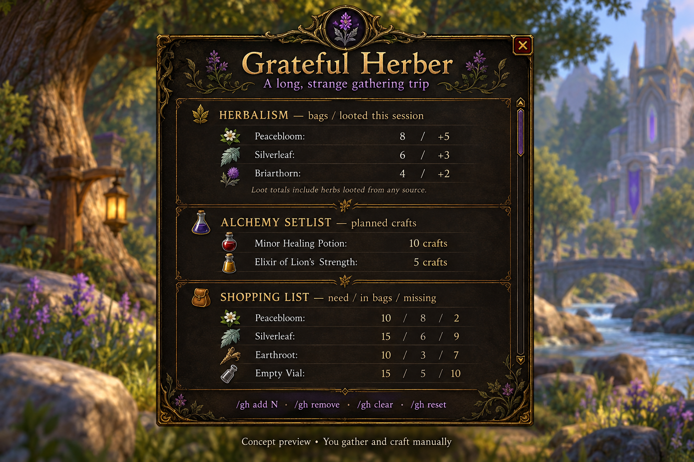

# Grateful Herber

A free, source-visible herbalism journal and Alchemy planner for WoW Classic Era,
with a Grateful Dead inspired purple and gold theme. Version **0.2.0**.

The image is an illustrated concept, not an in-game screenshot. The addon now
uses a five-page WoW window with item icons, controls, and adjustable text; it
does not reproduce the concept's illustrated border.

## Install

Download the release ZIP and extract the **GratefulHerber** folder into:

`World of Warcraft/_classic_era_/Interface/AddOns/`

`GratefulHerber.toc` must sit directly inside that folder. Restart WoW after first
installation so the client discovers the addon and its audio files. When using a
GitHub source ZIP, rename its outer folder to **GratefulHerber**.

The manifest targets interface **11508**. Verify your current Era client with
`/dump select(4, GetBuildInfo())` and adjust the TOC if needed. This build uses
Classic `GetTradeSkill*` APIs; Retail is not supported. In-game verification is
still required before calling this a tested release.

## Features

| Feature | Behavior |
| --- | --- |
| Herbalism journal | Bag inventory plus personal herb loot received this session. Loot can include corpses and containers, not only herb nodes. |
| Ready for the Show | Learned, scanned recipes with enough bag reagents, accounting for observed cooldowns and missing tools/stations. Rescan after moving to a station or changing tools. |
| Backstage Stash | Saved bank and alternate-character stock, optional in shopping calculations. Each snapshot has its own last-checked time. Same realm/faction characters only. |
| Encore Timers | Saved Alchemy cooldown observations and a reminder when the recorded timer should finish. Open Alchemy to refresh. |
| Scarlet Begonias Journal | Historical herb observations and manual world map pins. Automatic pins require a successful Herbalism cast followed by personal herb loot within five seconds. Locations are approximate. |
| Tour Planner | Named routes, ordered waypoints, and zone notes. Route marks appear on the world map; you advance the route yourself. |
| Set Break Stats | Session duration, herb loot/hour, confirmed gathering events, and best observed session rate after at least one minute. |
| Recipe Songbook | A 32-entry curated Classic Era source checklist, matched against recorded recipes. It is not a complete recipe database. |
| Packing List | Missing ingredients, low vial stock, and low general bag space reminders. |
| Ticket Price | Manual unit prices in copper, ingredient costs, minimum-output value, and gross margins per craft. No Auction House scanning or transactions. |
| Saved Setlists | Independent named crafting plans. Save a copy or start an empty plan, then switch between them. |
| Stage Lights | Five pages, item icons, larger text, shortage labels, remembered window placement, and a minimap leaf button. |
| Sound flair | Optional WoW chime or three bundled original musical cues; authorized local replacement clips are supported. Off by default. |

The shopping list combines shared reagents from every recipe in the active plan,
including vials. Quantities represent **crafts**, not output items. Shortages
use bags unless you enable saved stash counts. Crafting does not automatically
reduce your plan; adjust or remove entries afterward.

Open your own Alchemy window and scan it to record recipes. Scans observe only
visible entries; expand headers and clear filters for broader coverage. A recipe
marked **NOT RECORDED** may be unlearned, filtered out, or not yet scanned.
Recipe source notes describe reference locations, not current vendor stock.

## Controls

`/gh` or `/gratefulherber` opens the journal. Tabs select Journal, Alchemy, Stash,
Routes, and Settings. Escape closes it. You can enter commands in the window
without the `/gh` prefix; the Run button executes them.

| Command | Action |
| --- | --- |
| `/gh help` | Open Settings and command help. |
| `/gh page journal` | Open a page: journal, alchemy, stash, routes, or settings. |
| `/gh scan` | Record visible recipes in your own Alchemy window. |
| `/gh add 5` | Set selected Alchemy recipe to five planned crafts (1–999). |
| `/gh remove` | Remove selected recipe from the active plan. |
| `/gh clear` | Clear only the active plan. |
| `/gh plan new Raid Night` | Create and switch to an empty named plan. |
| `/gh plan save Raid Night` | Copy current plan to a new name and switch to it. |
| `/gh plan use Raid Night` | Switch to an existing plan. |
| `/gh plan list` | List saved plans. |
| `/gh plan delete Raid Night` | Delete an inactive plan. Switch away first. |
| `/gh stash on` / `/gh stash off` | Include/exclude saved bank and alt stock in shortages. |
| `/gh price 2447 50` | Value one Peacebloom at 50 copper. All prices are per item. |
| `/gh unprice 2447` | Remove that manual price. Missing prices never count as zero. |
| `/gh pin Favorite patch` | Add a historical/manual note at your current position. |
| `/gh route new Evening Tour` | Create and select a route. |
| `/gh route add Riverbank` | Add your current location to the active route. |
| `/gh route use Evening Tour` | Select a route and show the first point. |
| `/gh route next` | Advance to the next point, wrapping at the end. |
| `/gh route delete Evening Tour` | Delete a route. |
| `/gh note Check north shore` | Save a zone note. |
| `/gh reset` | Reset session loot and timer, preserving saved plans and best rate. |
| `/gh font 16` | Set text size (11–20). |
| `/gh threshold vials 5` | Set the low vial reminder threshold (0–100). |
| `/gh threshold bags 5` | Set the low general bag space threshold (0–100). |
| `/gh minimap off` / `/gh minimap on` | Hide/show the minimap button. |
| `/gh sound off` | Silence all addon cues. |
| `/gh sound builtin` | Enable the built-in WoW UI chime. |
| `/gh sound custom` | Enable bundled original musical cues or authorized replacements. |
| `/gh sound test` | Preview the herb cue in the selected sound mode. |

## Audio and addon rules

Three independently synthesized, short arpeggios are bundled: herb loot, Alchemy
spell success, and cooldown readiness. They contain no Grateful Dead recordings
or melodies. Automatic cues have an eight-second shared throttle and use the SFX
channel. Generation source is in `tools/make_cues.py`.

You may replace `Media/herb.ogg`, `Media/craft.ogg`, and `Media/ready.ogg` with short
compatible clips you created or have permission to use. Restart WoW after adding
files. Do not redistribute replacement songs without the required permissions.
A short excerpt, purchased recording, or freely accessible concert recording does
not by itself establish permission for bundling in a public addon.

Blizzard permits audio customization but explicitly warns against distributing
copyrighted audio without authorization. Grateful Dead recordings would need
appropriate recording and music permissions before an official song pack ships.

This addon displays information and saves plans. Movement, gathering, looting,
crafting, and purchases remain in your hands. It has no external helper, process
access, hidden-node detection, input simulation, chat spam, or protected-action
workarounds. It is free, with visible source, no ads, no premium features, and no
in-game donation prompts. This is not Blizzard approval or a compliance guarantee.

References:

- [Blizzard UI Add-On Development Policy](https://us.forums.blizzard.com/en/wow/t/ui-add-on-development-policy/24534)
- [Grateful Dead site terms](https://www.dead.net/terms)

## Data and limits

- Plans, learned recipes, prices, settings, and notes save per character.
- Bank/alt snapshots, historical pins, routes, and best rate save account-wide
  within the WoW installation. Characters must run this addon to contribute data.
- Bank counts update only while the bank is open. Alt bags update while that
  character is played. Transfers can make saved snapshots stale; check timestamps.
- Session loot resets on login/reload. Trades, mail, and bank withdrawals affect
  bag stock but not session loot.
- Historical observations are capped at 1,500; each route at 100 points; zone
  notes at 100. A historical pin never asserts that a node is currently present.
- Price estimates exclude Auction House cuts/deposits and are not live prices.
- Craftability uses bag reagents and observed cooldown/tool data; WoW's profession
  window remains the authority for crafting conditions.
- Map features require an available player map position. Other features continue
  working where coordinates or the world map are unavailable.

## Validation

Run `python tests/run.py` for mocked Lua integration checks. The runner needs a
Lua executable (5.1+) or a Lua 5.3/5.4 shared library, but no Python packages.
These tests are not a WoW client.

Before publishing a tested release, enable `/console scriptErrors 1` and check:

1. Login/reload, all five pages, text size, scrolling, dragging, Escape, minimap.
2. Alchemy scan with filters/headers, recipe plans, shared reagents, multi-output
   recipes, tool/station requirements, and cooldown refresh/notifications.
3. Bank transfers, two characters, stale timestamps, and stash-on/off shortages.
4. Personal vs other-player loot, gathering pins, map zoom/change, manual pins,
   saved routes, next waypoint, and unavailable coordinates.
5. Named plan isolation, reload persistence, invalid commands, zero/missing prices.
6. Low bag/vial reminders, silent default, built-in and original audio cues, and
   throttling. Verify no gameplay action occurs from addon controls.
